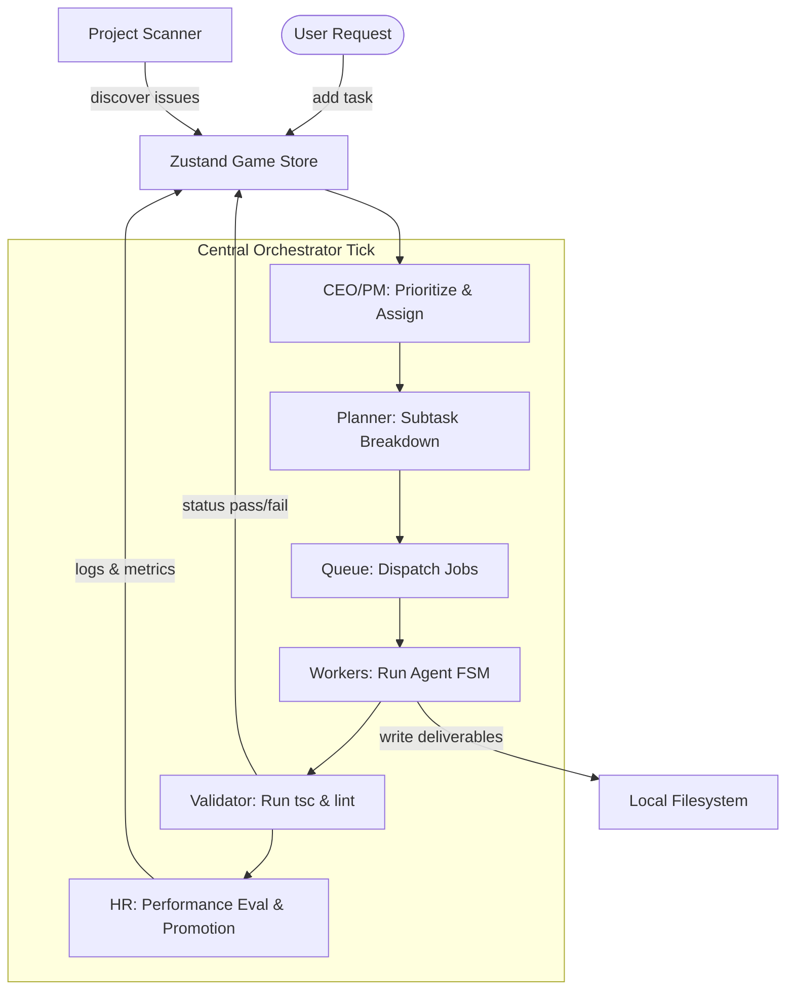

# 🤖 AgentCorp: Autonomous AI Agent Office & Operating System

<div align="center">
  <p><strong>A multi-agent autonomous simulation where AI agents collaborate, chat, and perform software engineering work in a 2D simulated office environment.</strong></p>
  
  [](https://nextjs.org)
  [](https://react.dev)
  [](https://phaser.io)
  [](https://zustand-demo.pmnd.rs/)
</div>

---

## 🌟 Overview

**AgentCorp** combines a **Phaser 2D virtual office simulation** (visual layer) with a **Next.js runtime** (execution layer) and real-time state management via **Zustand**. 

Unlike standard mock agent runs, AgentCorp is an autonomous loop where specialized agents (CEO, PM, Engineer, Researcher, QA, HR) collaborate on real software engineering work:
- 🔍 **Scanning the Codebase**: Discovers compilation errors, code style issues, or counts source files to generate task proposals.
- 🧠 **Task Decomposition**: PlannerAgent breaks high-level tasks into logical subtask sequences (max 5 subtasks).
- 🚀 **Sandbox Execution**: Worker agents execute real tool calls (reading directories, inspecting source code, and writing output deliverables).
- 🧪 **Automated Validation**: QAAgent and ValidatorAgent run automated compilation checks (`tsc`) and lints, with up to 3 automated debugging retries.
- 📈 **Performance & Compliance**: HR tracks efficiency, calculates morale, and manages agent promotions.

---

## 🎮 Virtual Office Live Simulation
The visual layout features a retro pixel-art office render:
* **Workstations & Desks**: Dedicated areas for PMs, Engineers, QA, and HR.
* **The Coffee Machine**: Agents automatically walk over to the coffee area to recharge when their energy falls below 40%.
* **Meeting Room**: Agents gather in the meeting room for status syncs and ambient chatter.
* **Server Racks**: Visually pulse to reflect system validation activities.

---

## 🏛️ System Architecture



---

## 🛠️ The Agent Roster

| Role | Role Title | Description & Behavior |
| :--- | :--- | :--- |
| **CEO** | Chief Executive | Prioritizes tasks in the pending queue based on project needs. |
| **PM** | Project Manager | Delegates prioritized tasks to available engineers, researchers, or QA workers. |
| **Engineer** | Developer Agent | Executes the code creation pipeline (search, read, generate code, write, verify). |
| **Researcher** | Analyst Agent | Performs information gathering, searches the workspace, and writes comprehensive markdown reports. |
| **QA** | Quality Assurance | Runs validation commands and feeds error stacks back to the developer if checks fail. |
| **HR** | People Operations | Evaluates team morale, tracks task completion metrics, and processes promotions. |

---

## 💻 Tech Stack

* **Core Runtime**: Next.js 16 (App Router), React 19 (Client-Side), TypeScript.
* **Game Engine**: Phaser 3 (2D Canvas Rendering, Agent A* Pathfinding).
* **State Management**: Zustand 5 (High-performance React/Phaser sync loop).
* **Styling**: Tailwind CSS + Framer Motion (Micro-animations, Glassmorphic overlays).
* **AI Engine**: Direct Google Gemini API Integration + OpenRouter Fallback.
* **Streaming**: Server-Sent Events (SSE) for execution console mirroring.

---

## 🚀 Getting Started

### Prerequisites
Make sure you have Node.js (v18+) and npm installed on your machine.

### Installation
1. Clone this repository:
   ```bash
   git clone https://github.com/Lakshay12356/agentcorporation.git
   cd agentcorporation
   ```
2. Install the dependencies:
   ```bash
   npm install
   ```

### Configuration
Create a `.env.local` file in the root directory and configure your API keys:
```env
# Gemini API Key (Required for AI actions)
GEMINI_API_KEY=your_gemini_api_key_here

# OpenRouter API Key (Optional fallback)
OPENROUTER_API_KEY=your_openrouter_api_key_here
```

### Running the App
Start the local development server:
```bash
npm run dev
```

Open [http://localhost:3000](http://localhost:3000) with your browser to experience the simulation!

---

## 📂 Deliverables Directory
All deliverables generated by worker agents (reports, codebase analyses, validation outputs) are written directly to the `./deliverables/` directory in the filesystem, providing a transparent record of agent work.

Enjoy exploring **AgentCorp**! 🚀
